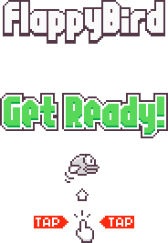

<div align="center">

# 🐤 Flappy Bird com Python e Pygame

**Projeto didático · Programação para Engenharia Mecânica · UFS/DMEC**



*Da primeira janela à programação orientada a objetos, física, colisões e persistência de dados.*

</div>

> **Projeto de aprendizagem:** os alunos constroem o jogo progressivamente, seguindo aulas teóricas e roteiros práticos. Este repositório não pressupõe que todas as funcionalidades já estejam implementadas no `src/main.py` inicial.

## 🎯 Objetivos de aprendizagem

Praticar **Python**, estruturas condicionais e de repetição, funções, classes, listas, eventos, animação em tempo real, modelagem simplificada do movimento, colisões, leitura e gravação de arquivos, **Git** e **GitHub**.

## 🖼️ Visão dos recursos gráficos

<div align="center">
  
</div>

*Imagens ilustrativas do conjunto de recursos do projeto; a aparência do jogo depende da sprint implementada.*

## 🚀 Como começar (Windows / VS Code)

Obtenha o projeto pelo GitHub (**Code → Download ZIP** ou `git clone`) e abra a pasta `flappybird` no VS Code. Leia primeiro `aulas/aula-00.0-obtencao-projeto-github.md` e `aulas/aula-01.1-roteiro-pratico.md`.

No terminal PowerShell, na raiz do projeto:

```powershell
py -3.12 -m venv .venv
.\.venv\Scripts\Activate.ps1
python -m pip install --upgrade pip
python -m pip install -r requirements.txt
python src/main.py
```

Se o ambiente virtual já estiver criado, **não é necessário recriá-lo**. Se a ativação estiver bloqueada, consulte as alternativas indicadas na Aula 01.1.

## 🎮 Controles por etapa

| Etapa | Comandos |
|---|---|
| Sprint 01 | Fechar a janela pelo **X** |
| Sprint 02 | **Espaço**: salto |
| Sprint 03 | **Espaço**: iniciar, saltar ou reiniciar; **Esc**: sair |
| Sprint 04 (após implementação) | **P**: pausar/retomar; **S**: ativar/desativar som; **T**: alternar tema; **Espaço**: jogar |

## 🗺️ Roadmap

| Sprint | Conteúdo | Material |
|---|---|---|
| 00 | Preparação e obtenção do projeto | Aula 00.0 e Aula 01.1 |
| 01 | Primeira janela Pygame | Aulas 01.0 e 01.1 |
| 02 | Física, gravidade, salto e animação | Aulas 02.0 e 02.1 |
| 03 | Obstáculos, colisões e pontuação | Aulas 03.0 e 03.1 |
| 04 | Vidas, pausa, áudio, recorde e tema | Aulas 04.0 e 04.1 |
| 05 | Testes, documentação e entrega | Planejada |

Os documentos de acompanhamento ficam em [`docs/roadmap.md`](docs/roadmap.md) e [`docs/sprints/`](docs/sprints/).

## 📁 Estrutura principal

```text
flappybird/
├── assets/
│   ├── imgs/         # sprites e imagens didáticas
│   └── audio/        # efeitos sonoros
├── aulas/            # teoria e roteiros práticos
├── docs/sprints/     # planejamento e critérios de aceitação
├── src/main.py       # código evolutivo do jogo
├── tests/            # testes da aplicação
├── .gitignore
├── README.md
└── requirements.txt
```

## 🔐 GitHub e direitos de uso

Cada estudante deve manter seu próprio repositório, conforme o primeiro envio explicado na **Aula 01.1**. **Antes de publicar este projeto em um repositório público, verifique as licenças e permissões de redistribuição das imagens e dos áudios de terceiros.** Enquanto essa verificação estiver pendente, utilize repositório privado e siga a orientação do professor. Não inclua a pasta `.venv/` nem dados pessoais de execução nos commits.

## 👨‍🏫 Créditos

© 2026 **Wilson Luciano** · **Programação para Engenharia Mecânica** · **Departamento de Engenharia Mecânica (DMEC)** · **Universidade Federal de Sergipe (UFS)**.  
Material didático do projeto **Flappy Bird com Python e Pygame**.
