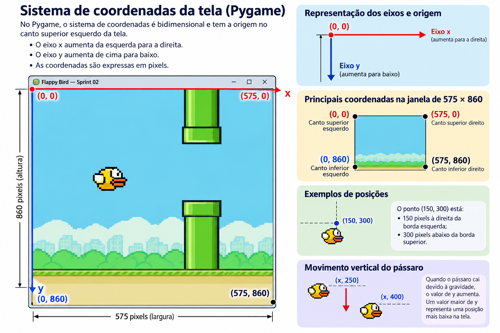

# Aula 02.0 — Física, movimento e animação do pássaro

**Disciplina:** Programação para Engenharia Mecânica — 2026.2  
**Projeto avaliativo 2:** Flappy Bird com Python e Pygame  
**Sprint:** 02 — Física, movimento e controles  
**Versão do material:** 0.2.2

## 1. Objetivos de aprendizagem

Ao final desta aula, o estudante deverá ser capaz de:

1. Explicar o sistema de coordenadas utilizado pelo Pygame e o significado do eixo vertical positivo para baixo.
2. Diferenciar posição, velocidade e aceleração em um modelo discreto.
3. Implementar gravidade e impulso de salto com parâmetros ajustáveis.
4. Compreender a relação entre FPS, tempo de quadro e estabilidade da simulação.
5. Separar **atualização do estado**, **tratamento de eventos** e **desenho**.
6. Aplicar escala gráfica à janela sem modificar as coordenadas físicas do jogo.
7. Carregar e animar sprites PNG organizados em `assets/imgs/`.
8. Verificar os critérios de aceitação da Sprint 02 e registrar o desenvolvimento no Git.

## 2. Continuidade da Sprint 01

Na Aula 01.1 foi criada uma janela Pygame com **resolução de referência de 575 × 860 pixels** e tamanho físico adaptado ao monitor. Até então, não havia objetos em movimento. Nesta sprint, a janela receberá um pássaro que cai sob a ação de uma gravidade simplificada e sobe quando o jogador pressiona **Espaço**.

O código prático completo será desenvolvido na **Aula 02.1**. A documentação de acompanhamento está em [`docs/sprints/sprint-02-fisica-movimento.md`](../docs/sprints/sprint-02-fisica-movimento.md).

## 3. Coordenadas cartesianas na tela

Em problemas tradicionais de Mecânica, é comum adotar o eixo vertical positivo para cima. Nas coordenadas gráficas do Pygame, porém, a origem `(0, 0)` está no **canto superior esquerdo**:

- `x` cresce da esquerda para a direita;
- `y` cresce de cima para baixo;
- reduzir `y` significa subir;
- aumentar `y` significa descer.



*Figura 1 — Origem, orientação dos eixos, posições e movimento vertical do pássaro.*

Consequentemente, neste jogo, a **gravidade é positiva** e o **impulso do salto é negativo**. A posição do pássaro pode ser representada por `(x, y)`, em pixels lógicos.

**Exemplo:** se `y = 300` e o pássaro sobe 8 pixels, sua nova posição será `y = 292`.

## 4. Modelo de movimento discreto

A velocidade vertical indica quanto a posição muda a cada quadro. A aceleração gravitacional indica quanto a velocidade aumenta a cada quadro. Utilizaremos um modelo simplificado com **passo temporal de um quadro**:

$$
v_{k+1}=v_k+g
$$

$$
y_{k+1}=y_k+v_{k+1}
$$

onde:

| Símbolo | Significado                         | Unidade didática |
| ------- | ----------------------------------- | ---------------- |
| `y`     | Posição vertical                    | pixel lógico     |
| `v`     | Velocidade vertical                 | pixel/quadro     |
| `g`     | Incremento de velocidade por quadro | pixel/quadro²    |
| `k`     | Índice do quadro                    | adimensional     |

Para manter compatibilidade com o projeto de referência, adotaremos inicialmente:

```python
GRAVIDADE = 1.1
IMPULSO = -8
FPS = 30
```

**Atenção à interpretação física:** `GRAVIDADE = 1.1` **não significa 1,1 m/s²**. É um parâmetro de aceleração em pixels lógicos por quadro ao quadrado, para uma atualização discreta. Também não é a aceleração gravitacional terrestre de 9,81 m/s².

### 4.1. Exemplo numérico

Considere `y_0 = 300`, `v_0 = -8` logo após um salto e `g = 1.1`:

| Quadro | Velocidade após aplicar gravidade | Posição vertical |
| ------ | --------------------------------: | ---------------: |
| 0      |                              −8,0 |            300,0 |
| 1      |                              −6,9 |            293,1 |
| 2      |                              −5,8 |            287,3 |
| 3      |                              −4,7 |            282,6 |
| 4      |                              −3,6 |            279,0 |

Inicialmente, o pássaro sobe (`v < 0`); depois, sua velocidade aproxima-se de zero e torna-se positiva, iniciando a descida. Os números resultam do método de **Euler semiexplícito** (atualiza primeiro a velocidade e depois a posição).

## 5. Controle do salto e eventos

Ao pressionar **Espaço**, o programa substitui a velocidade vertical pelo valor do impulso:

```python
velocidade_y = IMPULSO
```

Isso **não desloca instantaneamente** o pássaro: modifica a velocidade que será aplicada na atualização seguinte. Na implementação didática, trataremos `pygame.KEYDOWN` e verificaremos `pygame.K_SPACE`. Um evento de tecla pressionada produz uma ação de salto; a repetição automática do teclado pode variar conforme a configuração, por isso não devemos confundir `KEYDOWN` com um salto contínuo a cada quadro.

## 6. FPS e tempo de simulação

`relogio.tick(FPS)` tenta limitar a execução a no máximo `FPS` quadros por segundo, mas não garante intervalos perfeitamente iguais. Como nesta primeira versão somamos gravidade **uma vez por quadro**, a trajetória depende da frequência efetiva de atualização.

A escolha é deliberada para facilitar o estudo inicial de laços, variáveis e equações de diferenças. Em uma evolução posterior, poderemos empregar `dt` (tempo transcorrido) e expressar velocidades em pixels/segundo e acelerações em pixels/segundo². Não misture as duas convenções sem adaptar as fórmulas e os parâmetros.

## 7. Resolução lógica versus janela física

**Resolução lógica:** `575 × 860`, usada para posicionar o pássaro, calcular sua trajetória e definir os limites do cenário.  
**Resolução física:** tamanho da janela Pygame adaptada à resolução do monitor.

A solução consiste em desenhar em uma superfície lógica:

```python
cenario = pygame.Surface((LARGURA, ALTURA))
```

E, ao final de cada quadro, redimensionar a imagem pronta para a janela:

```python
imagem_final = pygame.transform.scale(cenario, (largura_janela, altura_janela))
tela.blit(imagem_final, (0, 0))
pygame.display.flip()
```

**Vantagem:** a física e as posições permanecem independentes do monitor. **Limitação:** uma escala fracionária pode produzir pequena perda de nitidez e diferenças de arredondamento; isso não altera as coordenadas lógicas. Nesta etapa não implementaremos redimensionamento manual da janela nem tratamento de barras laterais.

## 8. Classe `Passaro`: estado e responsabilidades

Organizaremos a lógica do pássaro em uma classe simples:

- **Atributos:** posição horizontal, posição vertical, velocidade vertical, lista de imagens e índice da animação.
- **Método `pular()`:** define a velocidade vertical como o impulso negativo.
- **Método `atualizar()`:** aplica gravidade, atualiza posição, verifica limites e avança a animação.
- **Método `desenhar()`:** representa o pássaro na superfície lógica.

Essa separação facilita testes, depuração e futuras expansões. O limite superior impede que o pássaro desapareça acima do cenário; ao atingir o solo, nesta sprint ele para de cair. **Perda de vidas, reinício e colisões com canos serão abordados em sprints posteriores.**

## 9. Imagens e áudios do pacote original

O projeto-base disponibilizado no GitHub já inclui em `assets/imgs/` e `assets/audio/` os recursos originais, incluindo os arquivos `imgs/bird1.png`, `imgs/bird2.png` e `imgs/bird3.png` (cada um com **34 × 24 pixels**), além de imagens de cenários, canos e arquivos de áudio como `audio/wing.wav`, `audio/hit.wav` e `audio/point.wav`.

No projeto-base, os recursos já estão organizados. A árvore parcial a seguir destaca os utilizados nesta sprint:

```text
flappybird/
├── assets/
│   ├── audio/
│   │   └── wing.wav
│   └── imgs/
│       ├── bird1.png
│       ├── bird2.png
│       └── bird3.png
├── aulas/
│   ├── aula-02.0-fisica-movimento.md
│   └── aula-02.1-roteiro-pratico.md
├── docs/
│   ├── roadmap.md
│   └── sprints/
│       └── sprint-02-fisica-movimento.md
└── src/
    └── main.py
```

_A árvore acima é parcial e mostra apenas os elementos relevantes desta sprint._

**Quando entram os recursos?** Nesta Sprint 02, usaremos os três sprites para animar as asas. O som `wing.wav` pode ser experimentado opcionalmente; seu uso definitivo e os demais efeitos de áudio serão aprofundados na Sprint 04. Imagens de canos, cenários e solo serão incorporadas na Sprint 03. A presença de um recurso no pacote original não significa, por si só, autorização para redistribuí-lo publicamente; antes de publicar no GitHub, verifique a origem e a licença de cada arquivo.

### 9.1. Caminhos relativos confiáveis

Como `main.py` fica em `src/`, devemos calcular a raiz do projeto a partir de `__file__`, e não presumir a pasta atual do terminal:

```python
from pathlib import Path
RAIZ = Path(__file__).resolve().parent.parent
PASTA_IMAGENS = RAIZ / "assets" / "imgs"
```

Assim, `PASTA_IMAGENS / "bird1.png"` aponta corretamente para o sprite, desde que o arquivo tenha sido copiado para a pasta indicada.

### 9.2. Transparência e animação

Os sprites PNG podem ser carregados com `pygame.image.load(...).convert_alpha()`, preservando transparência após a criação da janela. Para simular o bater de asas, alternaremos ciclicamente entre as três imagens, em intervalos definidos por um contador de quadros.

## 10. Sequência de implementação

1. Confirmar a execução da Sprint 01.
2. Conferir os três sprites já disponibilizados em `assets/imgs/`.
3. Criar a superfície lógica de 575 × 860 pixels.
4. Implementar a classe `Passaro` e a atualização da gravidade.
5. Tratar o salto pelo evento da tecla Espaço.
6. Desenhar o pássaro e alternar os sprites.
7. Redimensionar somente a imagem final para a janela física.
8. Testar limites verticais e registrar o commit da Sprint 02.

O roteiro operacional e o código integralmente comentado estão na **Aula 02.1**.

## 11. Critérios de aceitação da Sprint 02

- [ ] O pássaro aparece na janela com sprite carregado de `assets/imgs/`.
- [ ] A gravidade aumenta a velocidade de descida quando não há salto.
- [ ] Pressionar **Espaço** faz o pássaro subir.
- [ ] A animação alterna entre os três sprites.
- [ ] O pássaro não ultrapassa o topo e não atravessa o solo lógico.
- [ ] A janela permanece adaptada ao monitor, preservando as coordenadas lógicas.
- [ ] O programa fecha pelo **X** sem travar.
- [ ] As mudanças foram registradas em um commit local.

Esses critérios complementam o documento de planejamento existente da Sprint 02; não substituem suas orientações de registro e evidências.

## 12. Atividades de fixação

**Atividade 1 — Sinais:** explique por que o impulso é negativo e a gravidade positiva no Pygame.  
**Atividade 2 — Cálculo:** partindo de `v = -8` e `g = 1.1`, calcule `v` e `y` nos três primeiros quadros para `y_0 = 300`.  
**Atividade 3 — Experimento:** compare `GRAVIDADE = 0.8` e `GRAVIDADE = 1.4`. Qual valor produz uma queda mais rápida?  
**Atividade 4 — Animação:** altere o intervalo de troca dos sprites e descreva o efeito visual.  
**Atividade 5 — Engenharia:** explique por que a simulação baseada em quadros não deve ser interpretada diretamente como uma simulação física em unidades SI.

## 13. Referências e continuidade

- Aula 01.1 — janela inicial e adaptação ao monitor.
- Aula 02.1 — implementação prática da Sprint 02.
- `docs/roadmap.md` — visão geral do projeto.
- `docs/sprints/sprint-02-fisica-movimento.md` — acompanhamento e critérios.
- Documentação oficial do Pygame: <https://www.pygame.org/docs/>.

---

© 2026 **Wilson Luciano** · **Programação para Engenharia Mecânica** · **Departamento de Engenharia Mecânica (DMEC)** · **Universidade Federal de Sergipe (UFS)**.  
Material didático do projeto **Flappy Bird com Python e Pygame** · **Versão 0.2.2**.
